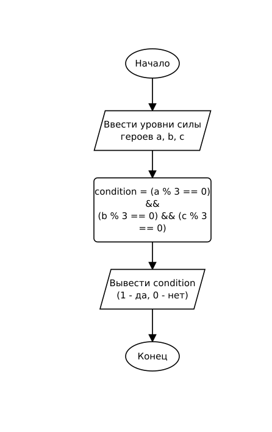

# Домашнее задание к работе 4

## Условие задачи (Вариант 2)

В игре три героя (A, B, C) атакуют босса. Их специальная способность «Тройной удар» активируется, только если уровень силы каждого из них кратен трем. Запишите условие активации способности.

---

## 1. Алгоритм и блок-схема

### Алгоритм

1. Запросить у пользователя уровень силы трех героев: `a`, `b`, `c`.
2. Вычислить логическое условие активации без использования условного оператора `if`:  
   `condition = (a % 3 == 0) && (b % 3 == 0) && (c % 3 == 0)`.
3. Вывести результат вычисления логического выражения (1 — да, способность активна; 0 — нет, не активна).
4. Завершить программу.

### Блок-схема



---

## 2. Реализация программы

Исходный код программы: [Source.c](Source.c)

---

## 3. Результаты работы программы

Пример работы программы при выполнении условия (все числа кратны 3):

```
Введите силу героя A: 9
Введите силу героя B: 15
Введите силу героя C: 21
Способность активирована (1 - да, 0 - нет): 1
```

Пример работы программы при невыполнении условия:

```
Введите силу героя A: 9
Введите силу героя B: 14
Введите силу героя C: 21
Способность активирована (1 - да, 0 - нет): 0
```

---

## 4. Информация о разработчике

- **ФИО:** Аносов Сергей Юрьевич
- **Группа:** бОТИ-261
